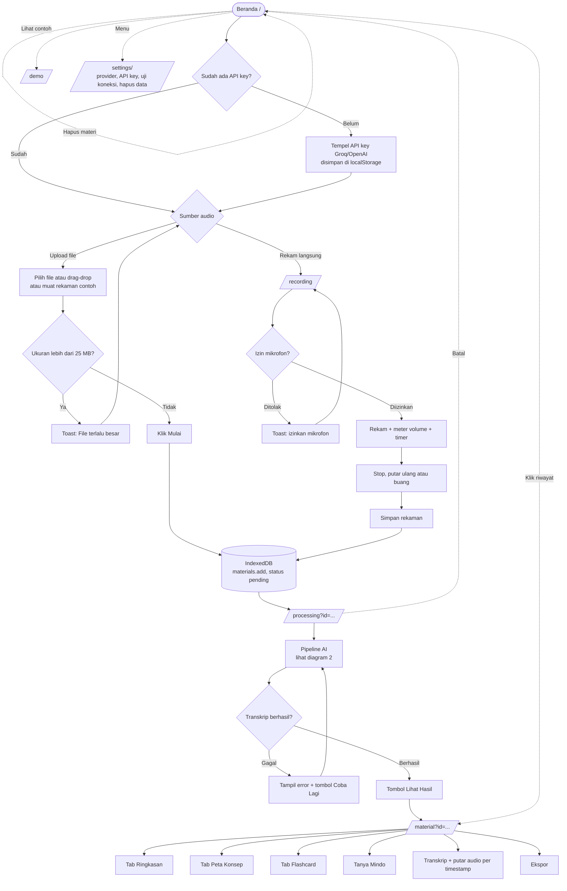
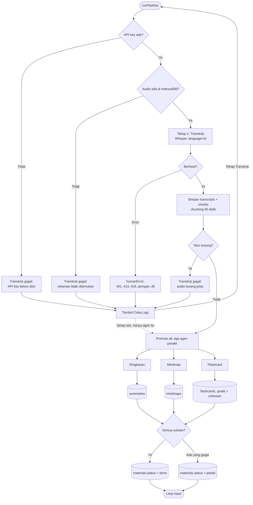
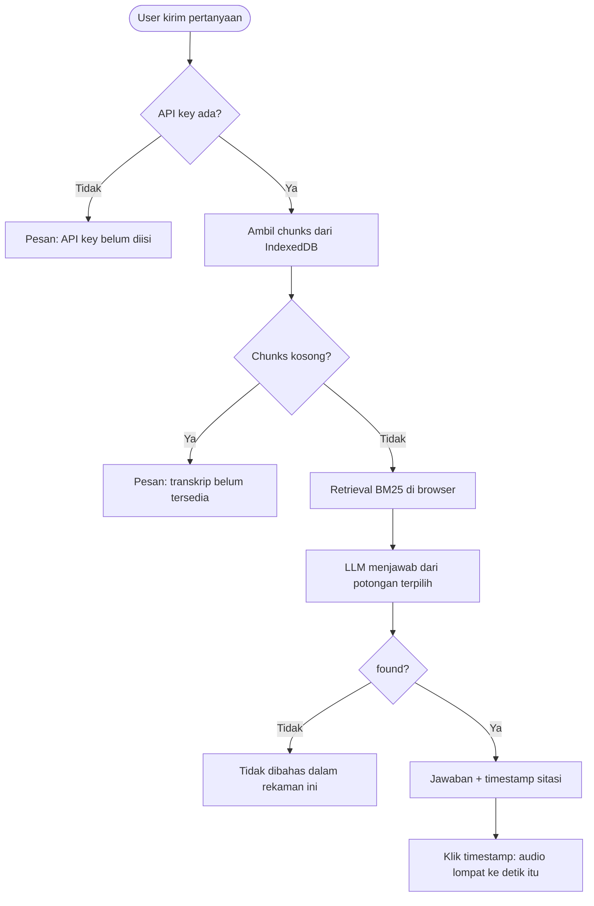

# Flowchart: Mindo

Diagram alur aplikasi, disusun dari kode di `src/app/*` dan `src/lib/*`. Versi teks biasa ada di `flowchart-teks.md`.

## 1. Alur pengguna (antar halaman)

## 2. Alur pemrosesan (`/processing`)

## 3. Alur Tanya Mindo (tutor AI di `/material`)

## Catatan

- Tidak ada backend. Browser memanggil provider (Groq/OpenAI) langsung, data tinggal di IndexedDB dan localStorage.
- Kegagalan per tahap terisolasi. Satu agen gagal, hasil agen lain tetap tersimpan (status `partial`). Retry agen hanya mengulang agen itu. Hanya retry transkrip yang mengulang seluruh pipeline.
- PRD menyebut "Dashboard" terpisah. Di kode, `/` sekaligus jadi landing, input upload, dan riwayat.
